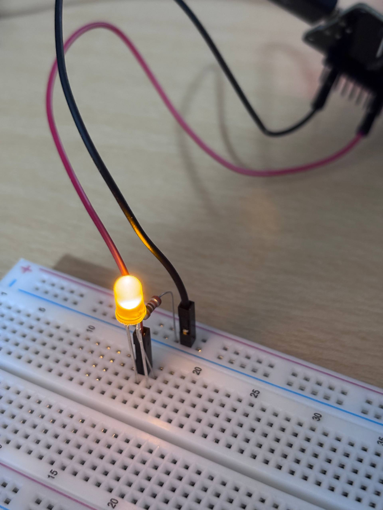

# Lab 01 — LED On

## Overview

This project demonstrates how to control an external LED using a GPIO output pin.

The LED turns on when the ESP32 starts and remains on.

## Components

- ESP32 DevKit
- LED
- 220Ω resistor
- Breadboard
- Jumper wires
- USB cable

## Wiring

| LED Component | ESP32 |
|---|---|
| Anode (long leg) | GPIO25 through 220Ω resistor |
| Cathode (short leg) | GND |



## Concepts

- GPIO output configuration
- Setting GPIO pin levels
- Digital HIGH and LOW signals
- Current-limiting resistors
- Basic LED circuit

## Build and Flash

Activate the ESP-IDF environment:

```
source ~/.espressif/tools/activate_idf_v6.1.sh
```

Navigate to the project directory:

```
cd labs/01-led-on
```

Build the project:

```
idf.py build
```

Flash the firmware:

```
idf.py flash monitor
```

## Expected Result

The external LED connected to GPIO25 turns on and stays on while the program is running.